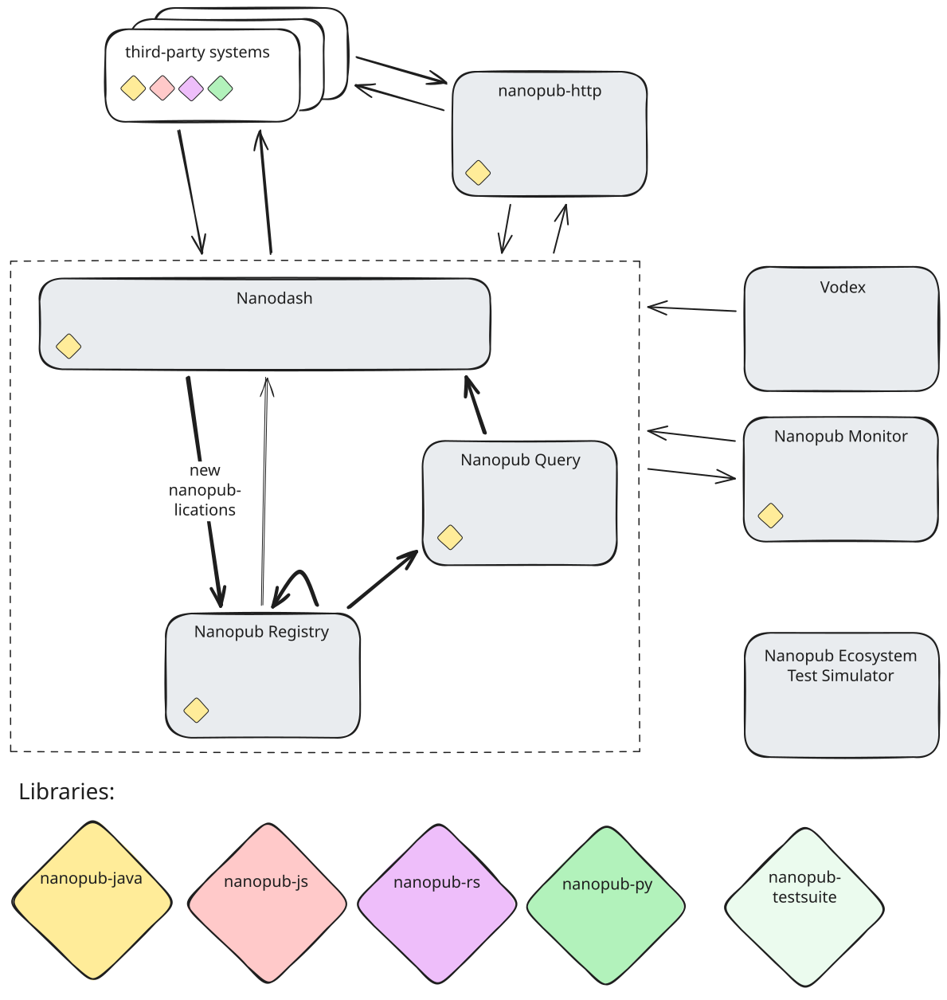

Nanopublications are published in a decentralized network of services and applications.
All components are open source, and the core services run as multiple instances.

  

## How it fits together

1. A client, such as Nanodash, a library, or the command-line tool, creates a nanopublication, signs it, and sends it to any **Nanopub Registry**.
2. The registries replicate nanopublications among each other.
3. **Nanopub Query** instances load the nanopublications from a registry into triple stores. They offer SPARQL endpoints over all nanopublications, as well as over subsets such as a single type, a single public key, or the last 30 days. They also offer a REST API whose queries are themselves published as nanopublications.
4. **Nanodash** and other applications read through Nanopub Query and publish through the registries.

Because nanopublications are immutable and identified by hashes, any copy can be checked against its URI, no matter which instance served it.

## Core components

**Nanopub Registry** ([instance](https://registry.knowledgepixels.com/), [code](https://github.com/knowledgepixels/nanopub-registry)) is the second-generation service for publishing and retrieving nanopublications in a decentralized fashion.

**Nanopub Query** ([instance](https://query.knowledgepixels.com/), [code](https://github.com/knowledgepixels/nanopub-query)) is the second-generation service to query nanopublications.
It allows for decentrally querying the published nanopublications via a number of SPARQL endpoints covering different subsets and aspects of nanopublications.

**Nanodash** ([instance](https://nanodash.knowledgepixels.com/), [code](https://github.com/knowledgepixels/nanodash)) is a general client and user interface for nanopublications.
It allows for user-friendly browsing, querying, and publishing of nanopublications, but can also be used as an API and intermediary layer for other services to build upon.

The legacy **nanopub-server** ([instance](https://np.knowledgepixels.com/), [code](https://github.com/tkuhn/nanopub-server)) still holds the old (unsigned) nanopublications, but otherwise no longer has a function in the latest generation of the ecosystem.

## Auxiliary components

**Nanopub Monitor** ([instance](https://purl.org/nanopub/monitor), [code](https://github.com/tkuhn/nanopub-monitor/)) observes the services that run the core components of the ecosystem.

**Vodex** ([code](https://github.com/knowledgepixels/vodex/)) is a vocabulary index service, used to provide auto-complete on third-party vocabularies.

**nanopub-http** ([code](https://github.com/knowledgepixels/nanopub-http/)) provides features of the nanopublication libraries over HTTP, most importantly signing and publishing.

## See also

- [A Robust Decentralized Infrastructure for Trust-Aware Open Knowledge Sharing](https://knowledgepixels.com/nanopub-ecosystem-paper/) (ISWC 2026), the paper that describes this ecosystem and its trust algorithm in detail
- [Tools](/docs/tools) for the libraries and the command-line tool
- [Applications](/docs/applications) for third-party systems that use nanopublications
