A research article can be corrected after publication, a web page can be edited, and a database entry can be overwritten.
If you cite any of these today, you cannot be sure what your reader will find there next year.

A nanopublication is different: once it is published, nobody can change it, not even its author.
This tutorial shows in pictures why that is, and how you still get to fix your mistakes.

It starts with a short introduction to what a nanopublication is.
If you know that already, skip to [a hash of the content](#a-hash-of-the-content).

## What is a nanopublication?

Let's start with a single statement: the ground beetle *Carabus granulatus* lives on arable land.
We can draw it as two dots joined by an arrow.

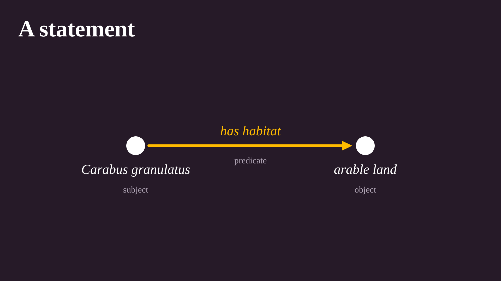

The dots are things, and the arrow says how they relate.
But "arable land" is just a phrase. Which beetle exactly, and what counts as arable land?
To leave no doubt, each of the three gets an identifier, and these identifiers look like web addresses.

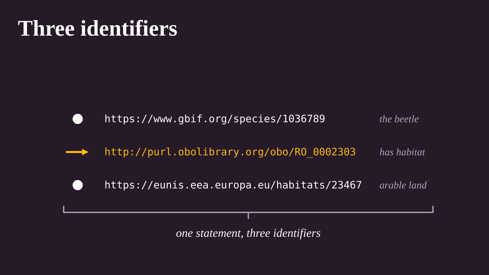

Open any of these identifiers in a browser and you find out what is meant: a species in a biodiversity database, a relation in an ontology, a habitat type in a European classification.
A program doesn't even have to look. To a program, two things with the same identifier are the same thing, in whatever dataset or language they turn up.

A statement made of three such identifiers is called a *triple*, and the identifiers are called *IRIs*.
This is how [RDF](https://www.w3.org/RDF/) represents knowledge, and it is all that a nanopublication is made of.
Every arrow in the pictures below is a triple, even where we only show the readable labels.

A statement on its own is not worth much, though.
Who says so? Based on what? Since when?
A nanopublication answers these questions by packaging three small sets of triples together.

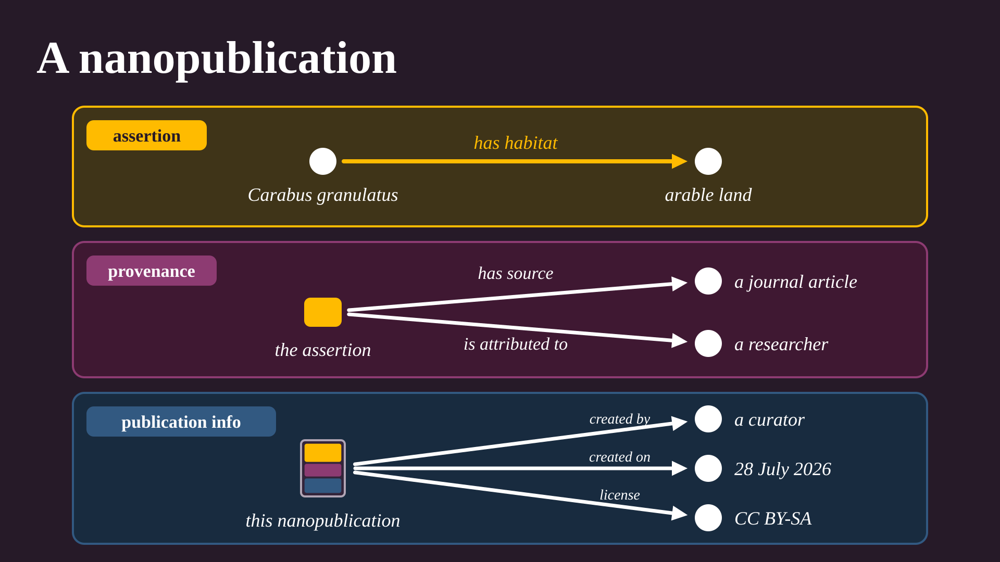

- The **assertion** is the statement itself.
- The **provenance** is about the assertion: where it comes from, and who stands behind it. This works because the assertion has an identifier of its own, so triples can point at it.
- The **publication info** is about the nanopublication as a whole, which has an identifier too: who created it, when, and under which license.

That is all a nanopublication is: a small unit of knowledge that carries its own context.
This one is [real](https://w3id.org/np/RAlohixCBWPuGLSKA7mmR8k01EQvC_dRWwAU70kvvwKPo), by the way, but the picture simplifies it.

One arrow was enough to make the point, but an assertion can hold as many triples as it needs.
The real beetle assertion has five.

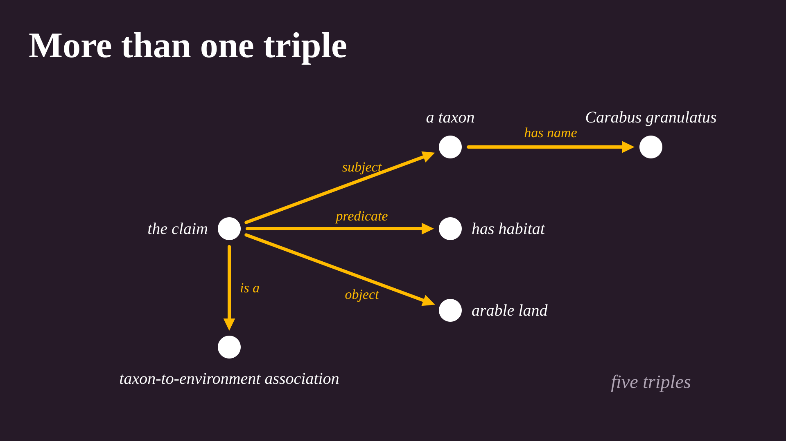

Here the claim itself is a dot with an identifier, and arrows lead from it to its subject, its predicate, and its object.
This takes more triples, but it makes the claim a thing that others can refer to.
Provenance and publication info usually have several triples too.

For the rest of this tutorial, we go back to simple examples, and draw a nanopublication as a little card with three colored parts, each with one triple inside.

## A hash of the content

A *hash function* takes any content and computes a short code from it, called a *hash*.
The same content always gives the same hash, and in practice no two different contents ever give the same one.
In the pictures, we draw a hash as a small pattern of squares.

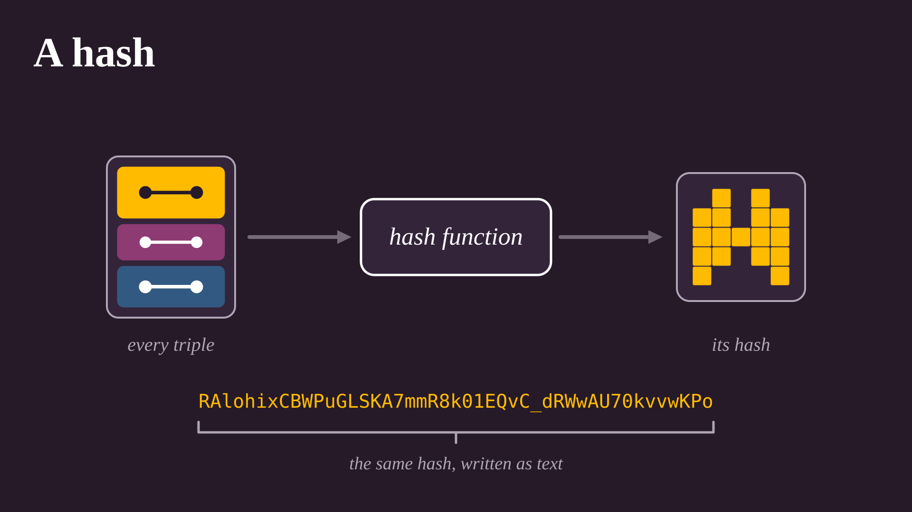

For a nanopublication, the hash is written as 45 characters.
The first two, `RA`, say what kind of hash it is. The other 43 are the hash value, computed over every triple in all parts of the nanopublication.

Now comes the trick that makes it all work: the hash becomes part of the nanopublication's identifier.

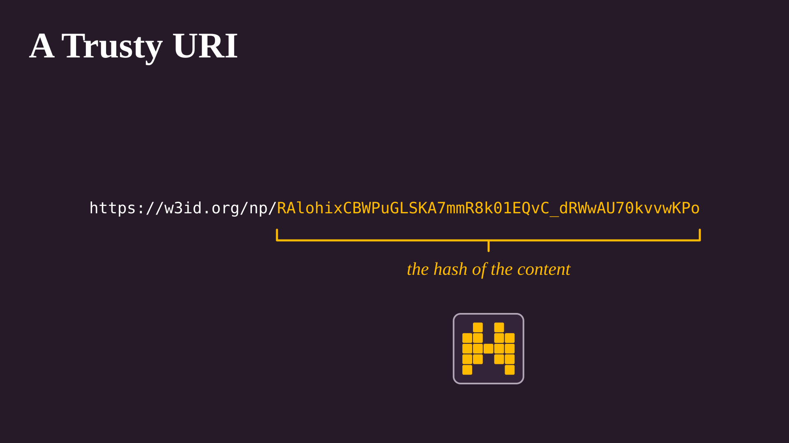

This kind of identifier is called a [Trusty URI](https://trustyuri.net/).
An ordinary identifier on the web only tells you where to ask.
A Trusty URI also tells you what you must get back.

## One small change

So what happens if somebody edits a published nanopublication?
It could be a server operator, an attacker, or the author having second thoughts.

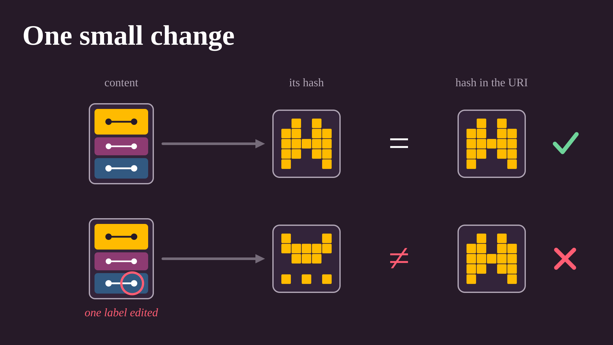

Even the smallest edit gives a completely different hash, and it no longer matches the one in the URI.
Anyone who has the content can do this check, without asking anybody for permission and without trusting the server it came from.

You can try it yourself with the command-line tool from the [quick start](/docs/#3-verify-a-nanopublication).
Download the beetle nanopublication, shorten one label in a copy, and check both:

```bash
curl -sL -H "Accept: application/trig" -o beetle.trig \
  https://w3id.org/np/RAlohixCBWPuGLSKA7mmR8k01EQvC_dRWwAU70kvvwKPo
sed 's/Linnaeus, 1758"/Linnaeus"/' beetle.trig > tampered.trig
np check beetle.trig tampered.trig
```

The original is reported as *trusty with signature*, the copy with *verification failed*.

This is what immutable means here.
Nothing stops you from editing the file, but the result is no longer the thing that the URI identifies.
It is something else, and everybody can see that.

## Who made it?

The hash tells you that the content is intact. It does not tell you who made it.
That is the job of a digital signature.

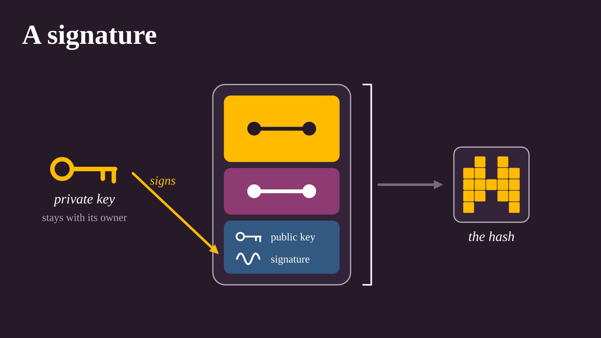

The author has a pair of keys.
The private key signs the nanopublication, and never leaves the author's hands.
The public key and the signature are stored in the publication info, so anyone can check that the two fit together.

The hash is computed last, over everything, signature included.
So the URI pins down not only what is said, but also which key said it.

A signature proves which key signed, not which person owns the key.
To connect a key to yourself, you publish an *introduction*: a nanopublication that says "this key belongs to this ORCID iD".

## Links that pin

Nanopublications refer to each other all the time: one supports a claim made in another, comments on it, or builds on it.
Such a link is a triple like any other, and the identifier it uses for the other nanopublication is its Trusty URI.
So the link does not just say where the other one lives. It carries the other one's hash.

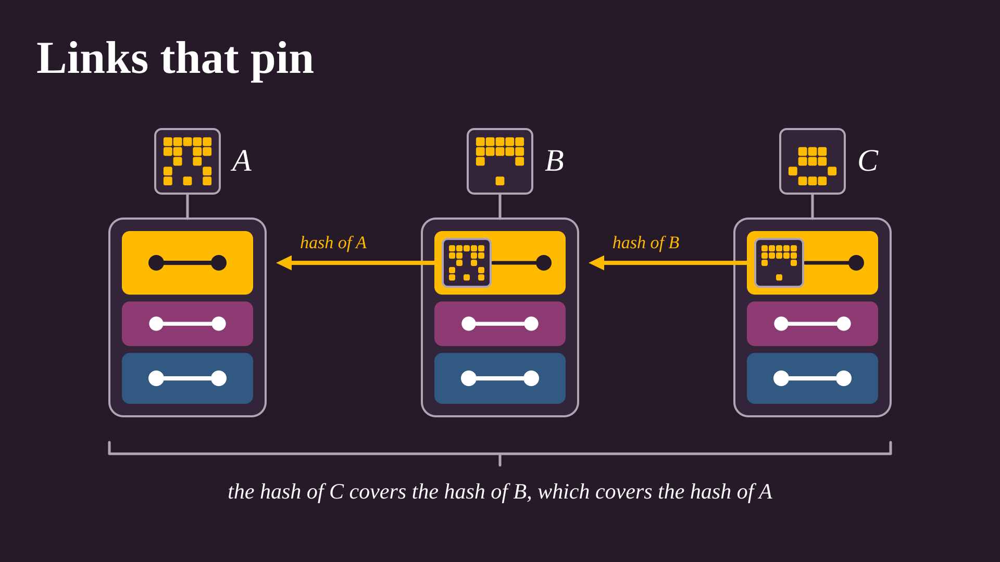

Look at C. One of its triples ends in the identifier of B, and that identifier ends in the hash of B.
This triple is part of the content of C, so the hash of B goes into the hash of C.
The same holds one step further, from B to A.

If you hold the Trusty URI of C, you have therefore pinned down B as well, and through B also A.
Nobody can swap in a different B without the link in C pointing somewhere else, and nobody can change that link without changing the hash of C.
One identifier can fix a whole chain of nanopublications, or a whole dataset.

## Changing your mind

All this sounds rather unforgiving.
What if you made a typo, or learned something new?

You don't change the nanopublication. You publish a new one that says it replaces the old one.

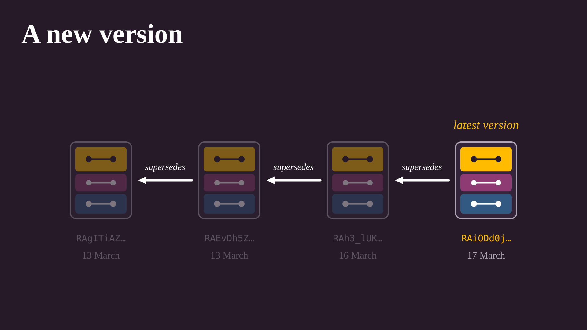

The picture shows a real case: the announcement of [Nano Session](/sessions) #29 was edited three times within a few days.
Each new version has one extra triple in its publication info: this nanopublication, *supersedes*, and the identifier of the old one.
For the last version in the picture, it is this one:

```turtle
<https://w3id.org/np/RAiODd0jLYxpvX3EHNpJfJr3mtcHgAo-QmYWoNYRqHvE0>
  npx:supersedes <https://w3id.org/np/RAh3_lUKDWIfbtay09Od5nvoX6rrG9ftxOal26v6qssu8> .
```

Again the link is made by hash, so there is no doubt about which exact version is being replaced.
The old versions stay on the network, so a citation of the first one still leads to exactly what was cited.
Services that show the current state of things follow the arrows backwards and display the latest version.

You can ask for the latest version yourself, starting from the first one:

```bash
API=https://query.knowledgepixels.com/api
curl -G $API/RAiRsB2YywxjsBMkVRTREJBooXhf2ZOHoUs5lxciEl37I/get-latest-version-of-np.csv \
  --data-urlencode "np=https://w3id.org/np/RAgITiAZA5yLltVB07D47Oo-kKVHOemwAkXnCq_ZYJtME"
```

And if a nanopublication should not be replaced but withdrawn, you retract it.

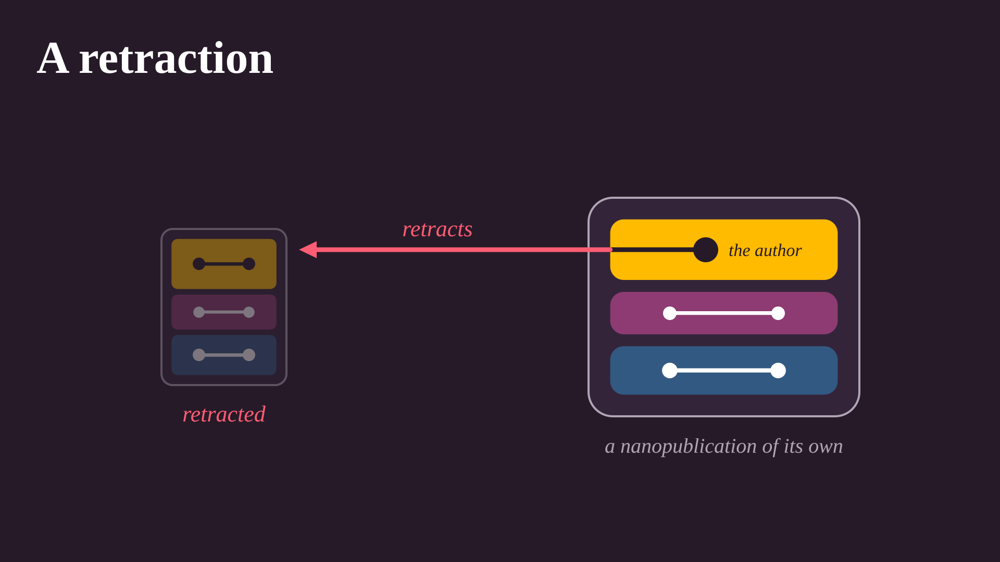

A retraction is again a nanopublication of its own.
Its assertion is a single triple: the author, *retracts*, and the identifier of the earlier one.
The retracted nanopublication does not disappear, but services that show the current state of things leave it out.
The history remains: what was said, and that it was taken back.

## Only with the same key

If anyone can publish a nanopublication that says it supersedes yours, can anyone replace your work?

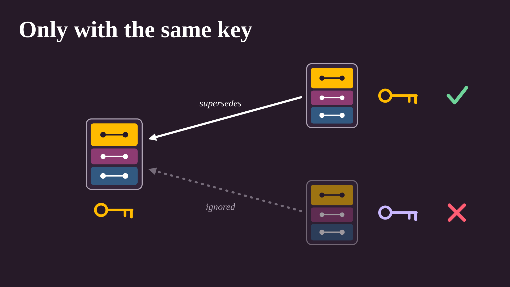

No. A new version or a retraction only counts if it is signed with the same key as the original.
Anything else is just somebody else's nanopublication that happens to mention yours.

This is also why you should take good care of your private key.
Without it, you can no longer update or retract what you published with it.

## Any copy will do

Because every nanopublication can be checked against its own identifier, it does not matter where you get it from.


Nanopublications are published to a network of servers that copy them from each other.
No server has to be trusted, and none is the "original" one.
If one goes offline, you ask another. If one hands you something modified, the hash gives it away.

## In short

- A nanopublication is a small set of triples, built from identifiers, together with its provenance and publication info.
- Its URI ends in a hash of its content, so every copy can be verified by anyone.
- It is signed, and the hash covers the signature, so the URI also fixes which key published it.
- A link to a nanopublication pins down its exact content, and everything that it links to in turn.
- To change something, you publish a new version or a retraction with the same key. The old one stays.

To try these things yourself, follow the [quick start](/docs/).
The [guidelines](/docs/guidelines) describe the structure of a nanopublication more formally, and the [technical architecture](/docs/architecture) explains the network of servers.
