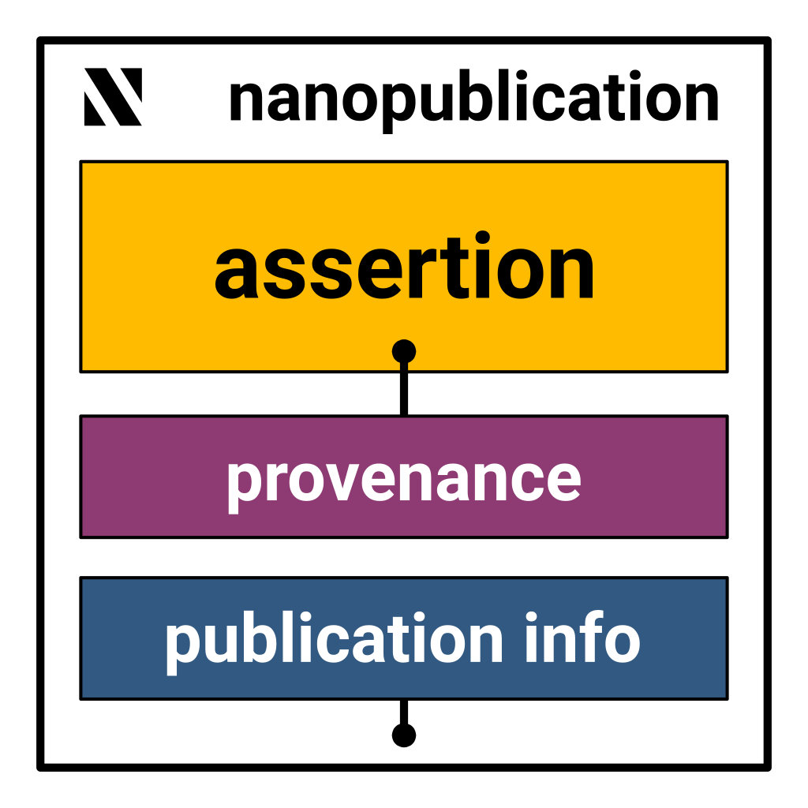

## What is a nanopublication?

A nanopublication is a small knowledge graph, such as a single claim, data point, or opinion, that is published together with its provenance and metadata as an independent, citable unit.
It can stand on its own or accompany a research article, and it can be about anything: a relation between a gene and a disease, the habitat of a beetle species, or the fact that someone has read a paper.

Nanopublications are written in [RDF](https://www.w3.org/RDF/), so they are formal and machine-interpretable. In addition, every nanopublication:

- **has a verifiable identifier**: its URI contains a hash of its content ([Trusty URI](https://trustyuri.net/)), so anyone can check that it has not been modified;
- **is signed** with its creator's key;
- **is immutable**: changes are made by publishing a new version that supersedes the old one, or a retraction;
- **lives on a decentralized network** of servers that replicate nanopublications and make them queryable with SPARQL.

## Structure

A nanopublication consists of three parts, each an RDF graph, tied together by a small head graph:

<div style={{textAlign: "center"}}>
    
</div>

1. **Assertion**: the main content, a small, atomic unit of information.
2. **Provenance**: how the assertion came to be, for example the scientific method or study it is based on.
3. **Publication info**: metadata about the nanopublication as a whole, such as who created it, when, and under which license.

## Example

This is a real nanopublication that links a species of ground beetle to a habitat type, shortened and in [TriG](https://www.w3.org/TR/trig/) syntax ([full version](https://w3id.org/np/RAlohixCBWPuGLSKA7mmR8k01EQvC_dRWwAU70kvvwKPo)):

```trig
@prefix this: <https://w3id.org/np/RAlohixCBWPuGLSKA7mmR8k01EQvC_dRWwAU70kvvwKPo> .
@prefix sub: <https://w3id.org/np/RAlohixCBWPuGLSKA7mmR8k01EQvC_dRWwAU70kvvwKPo/> .
@prefix np: <http://www.nanopub.org/nschema#> .
@prefix biolink: <https://w3id.org/biolink/vocab/> .
# ... more prefixes

sub:Head {
  this: a np:Nanopublication ;
    np:hasAssertion sub:assertion ;
    np:hasProvenance sub:provenance ;
    np:hasPublicationInfo sub:pubinfo .
}

sub:assertion {
  sub:association a biolink:OrganismTaxonToEnvironmentAssociation ;
    biolink:subject sub:taxon ;
    biolink:predicate obo:RO_0002303 ;      # has habitat
    biolink:object eunis:23467 .            # arable land and market gardens
  sub:taxon kpxl:hasTaxonName gbif:1036789 .  # Carabus granulatus
}

sub:provenance {
  sub:assertion dct:source <https://www.progress.plantprotection.pl/?node_id=35&lang=pl&ma_id=2725&a=2> ;
    prov:wasAttributedTo orcid:0000-0003-2711-4457 .
}

sub:pubinfo {
  this: dct:created "2026-07-28T17:06:19.425Z"^^xsd:dateTime ;
    dct:creator orcid:0000-0002-4587-3476 ;
    dct:license <https://creativecommons.org/licenses/by-sa/4.0/> .
  sub:sig npx:hasAlgorithm "RSA" ;
    npx:hasPublicKey "MIGfMA0GCSqGSIb3DQEBAQUAA4GNADCBiQKBgQCUDeKX..." ;
    npx:hasSignature "Nr/k02mkLbZG9ZCuCzOU7BSlVQoh/rOn9SGCCTmThSZa..." ;
    npx:hasSignatureTarget this: ;
    npx:signedBy orcid:0000-0002-4587-3476 .
}
```

The `RAlohixCBW...` part of the URI is a hash of the whole nanopublication, signature included. Change a single triple and it no longer matches.

## Why?

Because nanopublications can be attributed and cited, researchers get credit for publishing their data in standard, machine-readable formats.
This makes data easier to find, access, and reuse (see the [FAIR principles](https://www.go-fair.org/fair-principles/)), with or without an accompanying research article.

## Get started

- Read the [guidelines](/docs) and look at more [examples](/docs/examples).
- Browse, create, and publish nanopublications in your browser with [Nanodash](https://nanodash.knowledgepixels.com/).
- Use one of the [libraries](/docs/tools) for Java, Python, JavaScript, or Rust.
- Let an AI coding agent do it for you with the [nanopub Agent Skill](https://github.com/knowledgepixels/nanopub-skill).
- Read the [published articles](https://scholar.google.com/scholar?q=nanopublications) about nanopublications.
